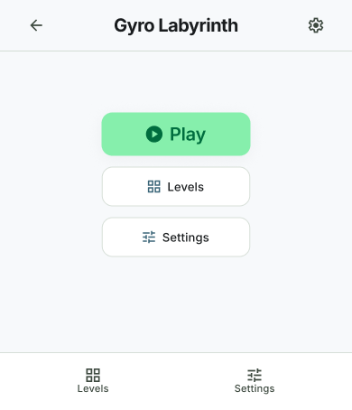
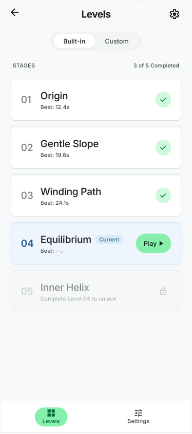
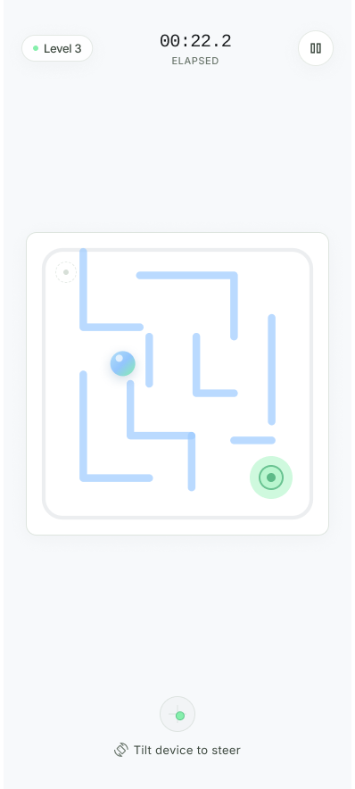
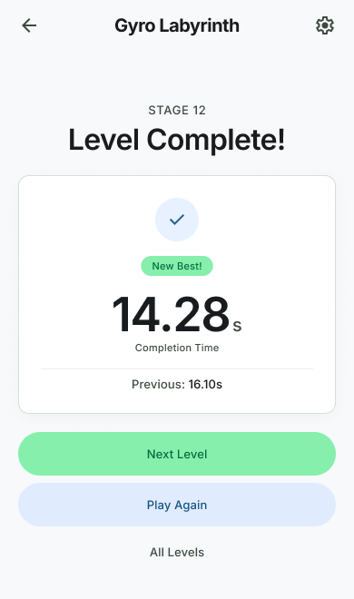
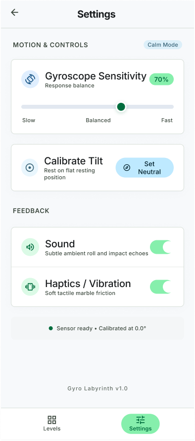

# Gyro Labyrinth

## Description

Gyro Labyrinth is a mobile game that challenges players to navigate a ball through complex mazes using their device's built-in gyroscope. The application provides endless replayability through a procedural level generator, empowers users to build their own custom mazes with a dedicated level editor, and tracks completion times for each level to encourage speedrunning and personal bests.

## App Screens

#### Main Menu

The central navigation hub providing quick access to gameplay modes, the editor, and settings.

#### Level Selection

A browsable list of available levels, categorized by pre-made, generated, and user-created. This screen displays the player's saved personal best time next to each level.

#### Gameplay Screen

The active game interface where players tilt their device to move the ball. Includes the labyrinth top-down view, a live timer, and a pause button.

#### Post-Level Summary

A results screen shown upon reaching the goal. It displays the completion time, indicates if a new record was set, and offers options to replay or return to the menu.

#### Settings

A configuration screen to adjust gyroscope sensitivity, toggle audio, and manage application preferences.

